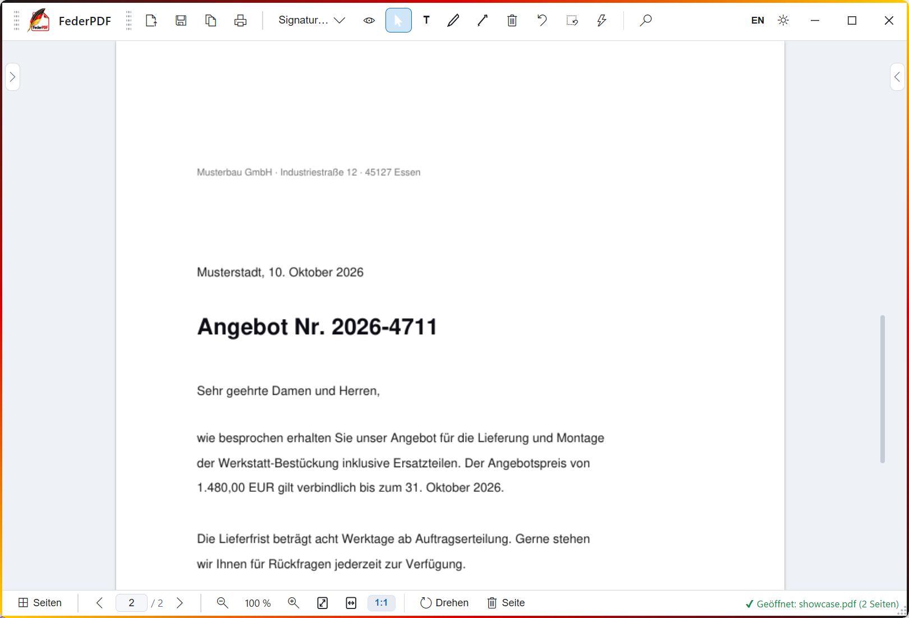
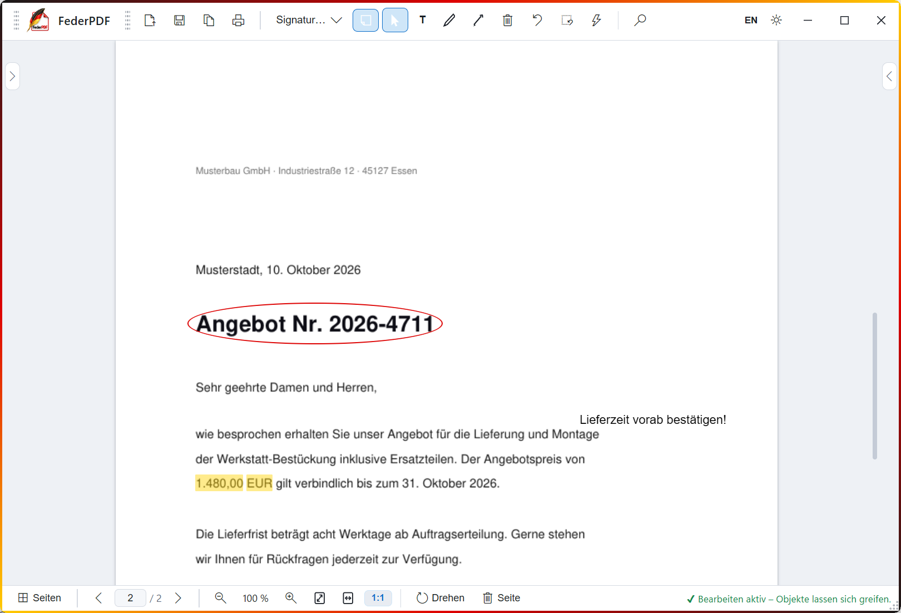

# FederPDF

**Der freie PDF-Editor für Windows — deutsch, lokal, ohne Cloud, ohne Telemetrie.**

FederPDF ist ein vollwertiges PDF-Programm: öffnen, lesen, bearbeiten, signieren,
markieren, schwärzen, OCR — alles läuft auf dem eigenen Rechner. Kein Konto, kein
Hintergrunddienst, keine Internetverbindung nötig (außer man schaltet den optionalen
KI-Assistenten mit seinem eigenen API-Schlüssel frei).

## Screenshots

| Lesemodus — ruhig zum Lesen | Bearbeitungsmodus — signieren & markieren |
|:---:|:---:|
|  |  |

## Download

Fertige Windows-Version (portable ZIP, keine Installation):
**[github.com/hilavoku/federpdf/releases](https://github.com/hilavoku/federpdf/releases)** —
ZIP entpacken, `FederPDF.exe` starten, fertig. Erhältlich für **x64**
(Intel/AMD) und **ARM64** (Windows on ARM, nativ). Enthält OCR-Sprachdaten
(Deutsch/Englisch) und die .NET-Runtime — benötigt wird nur die
[WebView2-Runtime](https://developer.microsoft.com/microsoft-edge/webview2/)
(auf Windows 11 vorinstalliert). Oder aus den Quellen bauen — siehe unten.

---

## English summary

**FederPDF** is a free, local PDF editor for Windows with a German-language UI.
It edits text, adds signatures (including password-protected ones), markup, shapes,
form fields and page operations, runs offline OCR (German/English) and includes
full-text search and an optional bring-your-own-key AI assistant. Architecture: a
WebView2 shell around a bundled local FastAPI + PyMuPDF server bound to
127.0.0.1 — nothing runs in the background, nothing leaves the machine.
Licensed under **GNU AGPL-3.0** (see LICENSE). UI and documentation are in German.

---

## Funktionen

- **Lesen- und Bearbeitenmodus** — die App startet ruhig; Bearbeitung wird bewusst freigeschaltet
- **Originaltext bearbeiten** — echter Text im Seiteninhalt ändern, ersetzen, löschen (Schwärzen); Freitext als bewegliche Annotation
- **Signieren** — Signaturen aufs Papier ziehen, skalieren, frei drehen; optional **passwortgeschützt** (AES-Verschlüsselung, Entsperrung nur im Arbeitsspeicher)
- **Markieren** — Textmarker, Unterstreichen, Durchstreichen, Wellige Linie
- **Zeichnen** — Rechteck, Oval, Linie, Pfeil, Freihand; Radiergummi
- **Formularfelder** ausfüllen und anlegen
- **Eingebettete Bilder** verschieben, skalieren, drehen
- **Seiten** drehen und löschen, Druckansicht, „Speichern unter“ (auch einbrennend)
- **OCR** — Deutsch + Englisch, vollständig lokal (Tesseract-Sprachdaten liegen bei)
- **Suche** im Volltext aller Seiten
- **KI-Assistent** (optional) — bring your own key: eigene Anbieter-URL + API-Schlüssel, Anfragen laufen direkt vom lokalen Server zum gewählten Anbieter
- **Undo** für fast alles (Strg+Z)

## Wie es funktioniert (Architektur)

FederPDF ist ein normales Windows-Programm mit zwei Teilen:

1. **Fenster** (C#/WinForms, WebView2) — Zeichnen der Oberfläche, Fenster-Verwaltung, Datei-Dialoge
2. **lokaler PDF-Server** (Python, FastAPI + PyMuPDF) — wird als unsichtbarer Kindprozess gestartet, lauscht **nur auf 127.0.0.1**, wird beim Schließen beendet

Die Oberfläche ist eine einzelne HTML-Seite (vanilla JS); Signaturen, Texte, Formen
und Markierungen sind HTML-Overlays **und** echte PDF-Annotationen — Dateien bleiben
also in anderen PDF-Programmen vollwertig benutzbar.

**Nach Feierabend läuft nichts im Hintergrund.**

## Voraussetzungen

- Windows 10/11 (WebView2-Runtime ist bei Windows 11 dabei; für Windows 10:[
  https://developer.microsoft.com/microsoft-edge/webview2/](https://developer.microsoft.com/microsoft-edge/webview2/))
- Zum **Bauen**: Python 3.14 (`py`-Launcher), .NET SDK (für den Fenster-Wrapper)

## Selbst bauen

Repository klonen, dann:

```bat
:: 1) Server bauen (PyInstaller, ~105 MB inkl. Kryptografie + OCR-Sprachdaten)
powershell -File build_server.ps1
::    Ergebnis: app\dist\FederPDFServer\FederPDFServer.exe

:: 2) Fenster-Wrapper bauen
dotnet publish wrapper\FederPDF.csproj -c Release -o paket

:: 3) Server neben die EXE legen (Ordner "server" neben FederPDF.exe,
::    Inhalt von app\dist\FederPDFServer hinein)
:: 4) paket\FederPDF.exe starten
```

### Nur den Server ausprobieren (ohne Windows-Programm)

Der Server liefert die komplette Oberfläche selbst aus — ein Browser genügt:

```bat
py -3.14 -m venv venv
venv\Scripts\pip install pymupdf fastapi "uvicorn[standard]" python-multipart pillow cryptography
venv\Scripts\python app\server.py --port 8515
:: dann http://127.0.0.1:8515 öffnen
```

Für OCR zusätzlich den Inhalt von `tessdata\` in einen Ordner `tessdata\` neben
der Server-Arbeitsdatei legen (das Build-Skript macht das automatisch).

## Tests

Die Testsuite startet den gebauten Server auf Port 8515 und prüft die API
ende-zu-ende (89 Checks: Signaturen inkl. Passwortschutz, Text, Formen,
Markieren, OCR, Bilder, Undo, Speichern). Sie erzeugt eigene Wegwerf-Signaturen
und Fixtures — Nutzerdaten werden nie angefasst.

```bat
pip install requests pymupdf pillow
py -3.14 tests\pdfwerkstatt_test.py
:: abweichender Server-Pfad:
set PW_EXE=C:\Pfad\zu\FederPDFServer.exe
py -3.14 tests\pdfwerkstatt_test.py
```

## Datenschutz

- **Keine Telemetrie**, keine Update-Pings, keine Konten, keine Cloud.
- PDFs verlassen den Rechner nie.
- **Passwortgeschützte Signaturen** werden verschlüsselt gespeichert (AES; der
  Schlüssel wird aus dem Passwort abgeleitet). Das Passwort selbst wird nie
  gespeichert, und das entschlüsselte Signaturbild liegt nur im Arbeitsspeicher —
  so lange die App läuft.
- Der KI-Assistent ist standardmäßig aus; schaltet man ihn frei, gehen nur die
  selbst formulierten Anfragen direkt (vom lokalen Server) zum selbst gewählten
  Anbieter. Der API-Schlüssel wird nur lokal in der Konfigurationsdatei gespeichert.

## Lizenz

Copyright © 2026 Guido Nekes

Dieses Programm ist freie Software: lizenziert unter der **GNU Affero General
Public License v3.0** (LICENSE). Sie dürfen es nutzen, untersuchen, ändern und
weitergeben — auch kommerziell — unter den Bedingungen der AGPL-3.0.

Die Wahl dieser Lizenz ist der PyMuPDF-Bibliothek geschuldet, die den Kern der
PDF-Verarbeitung bildet. Wichtige Drittanbieter-Komponenten:

| Komponente | Lizenz |
|---|---|
| [PyMuPDF](https://pymupdf.readthedocs.io/) | AGPL-3.0 |
| [FastAPI](https://fastapi.tiangolo.com/) / Starlette | MIT / BSD-3 |
| [uvicorn](https://www.uvicorn.org/) | BSD-3 |
| [Pillow](https://python-pillow.org/) | MIT-CMU |
| [python-multipart](https://github.com/kludex/python-multipart) | Apache-2.0 |
| [cryptography](https://cryptography.io/) | Apache-2.0 / BSD-3 |
| [PyInstaller](https://pyinstaller.org/) | GPL-2.0-or-later (Bootloader-Ausnahme) |
| [Tesseract OCR](https://github.com/tesseract-ocr/tesseract) + tessdata (deu/eng) | Apache-2.0 |
| [Microsoft WebView2](https://developer.microsoft.com/microsoft-edge/webview2/) | redistributable Runtime |
